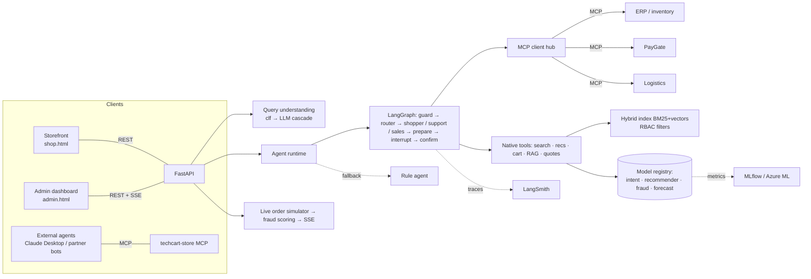
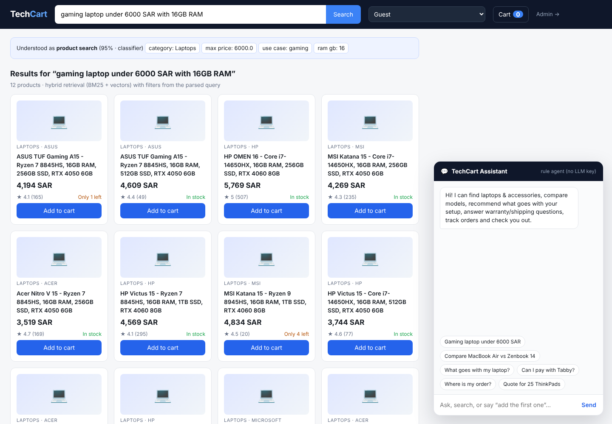
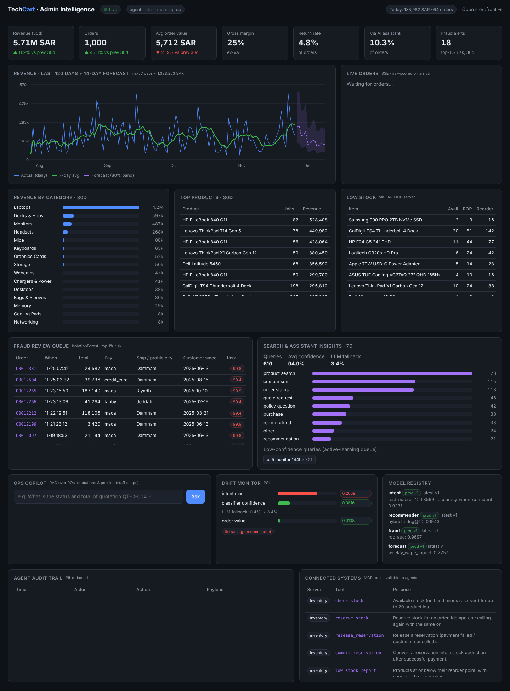

# TechCart — Agentic AI + RAG platform for a computer & accessories store

An end-to-end, open-source reference system for an online laptop/PC/accessories shop (KSA market, prices in SAR):

- **Smart search**: a cost-aware query understanding cascade (TF-IDF classifier, then an LLM only when the classifier isn't confident), hard filters taken from the parsed query, and hybrid retrieval (BM25 + vectors).
- **Next-purchase recommendations**: a hybrid co-purchase, sequence and content model, tuned on a temporal split and checked against baselines.
- **Agents that complete a purchase end to end**: LangGraph multi-agent routing, a deterministic payment saga, and human-in-the-loop confirmation through `interrupt()`.
- **MCP integrations**: ERP/inventory, payment gateway and logistics run as separate MCP servers. The store itself is also exposed as an MCP server, so external agents such as Claude Desktop can use it.
- **RAG with citations and security trimming**: policies, product sheets, purchase orders, quotations and receipts. Retrieval is scoped by role (customer, staff, owner) inside the index.
- **Two dashboards**: an admin view (KPIs, forecast, live risk-scored order stream, fraud queue, drift, model registry, ops copilot) and a customer storefront (personalised recommendations, smart search, assistant with checkout).
- **MLOps**: model registry with promotion gates, MLflow/Azure ML tracking hook, PSI drift monitoring, scheduled continuous training in CI, and LangSmith tracing and evals.
- **Responsible AI and PDPL**: consent-gated personalisation, PII redaction, an audit trail, explainable fraud reasons and model cards.

Stack: **Azure OpenAI (Microsoft Foundry)**, LangGraph, LangSmith, MCP Python SDK v2, FastAPI, scikit-learn, SQLite (swap for Azure SQL/Postgres). Without an Azure key, everything still runs: local hashing embeddings, a rule-based agent and in-process MCP. That keeps CI and demos reliable. A component-by-component **Vertex AI mapping** is in [`docs/AZURE_TO_GCP.md`](docs/AZURE_TO_GCP.md).



| Customer storefront (smart search + assistant) | Admin intelligence dashboard |
|---|---|
|  |  |

## Quick start

```bash
python -m venv .venv && source .venv/bin/activate
pip install -e ".[dev]"            # add ".[mlops]" for MLflow
cp .env.example .env               # optional: Azure OpenAI + LangSmith keys
make bootstrap                     # HF catalog → synthetic transactions → train/register models → RAG index → search logs
make api                           # http://localhost:8000 (shop) · /admin · /docs (OpenAPI)
make test                          # 20 tests (no API keys needed)
```

With Azure OpenAI configured (`AGENT_MODE=llm`), the assistant runs on the LangGraph graph, `make index` uses `text-embedding-3-small`, and `make eval ARGS=--langsmith` runs LLM-as-judge experiments in LangSmith.
To run MCP across processes, use `make mcp-http`, then `MCP_MODE=http make api`, or run `docker compose up` (four services).

## Data

| Source | What | How |
|---|---|---|
| Hugging Face [`McAuley-Lab/Amazon-Reviews-2023`](https://huggingface.co/datasets/McAuley-Lab/Amazon-Reviews-2023) (`raw_meta_Electronics` Parquet) | The **only** product source: real titles, features, descriptions, prices, ratings and images, filtered to *Computers & Accessories*, mapped leaf-first to 15 store categories, with specs (RAM, SSD, screen, GPU, CPU) parsed from `details` | `make seed` streams the shards until each category quota is filled (up to ~460 products), caches to `.cache/catalog_hf.jsonl`; `make seed-refresh` re-downloads |
| Synthetic generator (seeded) | 18 months of orders with KSA seasonality (White Friday, Ramadan, back-to-school), personas, complementary baskets, repeat "next purchase" behaviour, labelled fraud patterns; suppliers, **purchase orders, supplier and customer quotations, receipts**, inventory | `src/techcart/data/generate.py` |
| Policy corpus | Returns, warranty/TechCare+, shipping, payments (mada/Tabby/COD), B2B, PDPL privacy notice, buying guide | `src/techcart/data/policies.py` |
| RAG eval set | 63 questions with **gold document ids** generated alongside the data | `data/rag_eval.jsonl` |

For document-AI extensions, [`mychen76/invoices-and-receipts_ocr_v1`](https://huggingface.co/datasets/mychen76/invoices-and-receipts_ocr_v1) provides OCR'd invoices and receipts that can feed an LLM extraction pipeline into the same `receipts` schema.

## Results (seed 42; re-run `make train` after seeding from Hugging Face to get your numbers)

| Component | Metric | Value | Baseline |
|---|---|---|---|
| Intent classifier (tier 1) | macro-F1 on hand-written test set | **0.86** | — |
| | accuracy when confident (τ = 0.55) / coverage | **0.92** / 83% | the remaining 17% go to the LLM tier |
| Recommender (tuned hybrid) | NDCG@10 / HitRate@10, temporal split | **0.199 / 0.46** | co-basket 0.177 / 0.40 · popularity 0.122 / 0.30 |
| Fraud (IsolationForest) | ROC-AUC / PR-AUC (base rate 0.8%) | **0.97 / 0.24** | random PR-AUC = 0.008 |
| Revenue forecast | weekly WAPE, 28-day backtest | **0.15** | seasonal-naive 0.31 |
| RAG retrieval | hit@5 / MRR (hybrid) | **1.00 / 0.89** | BM25 0.97 / 0.83 |
| RAG security | internal docs returned to customers | **0** | — |

These are honest numbers on synthetic data. The classifier's test set was used during template iteration, so treat it as a dev set; production logs become the real holdout. The fraud anomalies are synthetic and only partly separable on purpose. See [`docs/MODEL_CARDS.md`](docs/MODEL_CARDS.md).

## Repository map

```
src/techcart/
  data/        catalog.py (Hugging Face loader + spec parser) · generate.py (orders, POs, quotes, receipts, docs) · policies.py
  ml/          intent.py · recommender.py · fraud.py · forecast.py · drift.py · tracking.py (registry + MLflow)
  rag/         chunking.py · embeddings.py (Azure/hashing + cache) · store.py (BM25+vector+RRF, Azure AI Search) · retriever.py · evaluate.py
  agents/      graph.py (LangGraph) · rule_agent.py · checkout.py (MCP saga) · mcp_bridge.py · tools.py · runtime.py
  mcp_servers/ inventory_erp.py · payments.py · shipping.py · techcart_store.py
  api/         main.py (FastAPI) · analytics.py · simulator.py (SSE)
  web/         shop.html · admin.html · charts.js (dependency-free SVG charts)
  search.py · services.py · guardrails.py · llm.py · config.py
scripts/       seed · train_all · build_index · eval_rag · monitor_drift · simulate_traffic · finetune_intent_aoai
docs/          AZURE_TO_GCP.md · RESPONSIBLE_AI.md · MODEL_CARDS.md · DEMO_SCRIPT.md
```

## Design decisions worth discussing

1. **Cascade before LLM.** Most queries are cheap to classify. The LLM runs only when the classifier's confidence is below τ, which keeps cost and latency down. τ is a business dial, and the rising fallback rate doubles as a drift signal.
2. **The LLM decides *what*, code decides *how* money moves.** Checkout is a deterministic saga: reserve, quote, payment intent, a human confirmation via `interrupt()`, then confirm, commit and ship. Each step is idempotent and has a compensating action. A retried tool call can't double-charge.
3. **Security trimming happens in retrieval, not in the prompt.** Customers can only retrieve `public` documents, receipts are row-level scoped to their owner, and staff can see POs and quotations. An eval asserts zero leaks.
4. **Hybrid retrieval plus an identifier short-circuit.** Vectors handle paraphrase, BM25 handles SKUs and IDs, and RRF fuses them without score calibration. Exact IDs such as `QT-C-0041` bypass ranking entirely.
5. **Transparent relaxation.** When no product matches, the search drops constraints in a fixed order and tells the user which ones it dropped, instead of showing an empty page.
6. **Graceful degradation.** If the LLM is down, the rule agent and extractive RAG take over, so the shop keeps selling.
7. **MCP as the integration contract.** The same ERP, payment and logistics tools serve the LangGraph agent, the admin dashboard and any external MCP client, whether in-process, over stdio or over HTTP.

MIT licensed. Data is synthetic or public. TechCart is fictional.
