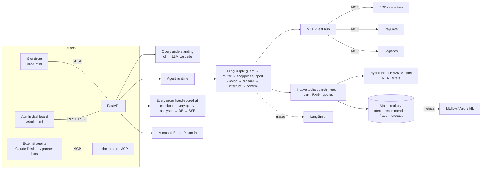

# TechCart — Agentic AI + RAG platform for a computer & accessories store

An end-to-end, open-source reference system for an online laptop/PC/accessories shop (KSA market, prices in SAR):

- **Smart search**: a cost-aware query understanding cascade (TF-IDF classifier, then an LLM only when the classifier isn't confident), hard filters taken from the parsed query, and hybrid retrieval (BM25 + vectors).
- **Next-purchase recommendations**: a hybrid co-purchase, sequence and content model, tuned on a temporal split and checked against baselines.
- **Agents that complete a purchase end to end**: LangGraph multi-agent routing, a deterministic payment saga, and human-in-the-loop confirmation through `interrupt()`.
- **MCP integrations**: ERP/inventory, payment gateway and logistics run as separate MCP servers. The store itself is also exposed as an MCP server, so external agents such as Claude Desktop can use it.
- **RAG with citations and security trimming**: policies and product sheets, plus every receipt, quotation and purchase order once it has been created in the app. Retrieval is scoped by role (customer, staff, owner) inside the index.
- **Two dashboards**: an admin view (KPIs, live feed of real orders/queries/assistant turns, risk-scored orders, fraud queue, query intelligence, drift, model registry, ops copilot) and a customer storefront (recommendations, smart search, assistant with checkout).
- **Microsoft Entra ID sign-in**: customers and admins sign in with a Microsoft account (MSAL auth-code flow + PKCE, server-side sessions). Admin access comes from an e-mail allow-list.
- **No fake activity**: there are no generated customers, orders or chat replies. Every number on the admin page comes from something that actually happened in the app and was analysed and stored in the database.
- **MLOps**: model registry with promotion gates, MLflow/Azure ML tracking hook, PSI drift monitoring, scheduled continuous training in CI, and LangSmith tracing and evals.
- **Responsible AI and PDPL**: consent-gated personalisation, PII redaction, an audit trail, explainable fraud reasons and model cards.

Stack: **Azure OpenAI (Microsoft Foundry)**, Microsoft Entra ID, LangGraph, LangSmith, MCP Python SDK v2, FastAPI, scikit-learn, SQLite (swap for Azure SQL/Postgres). The assistant runs **only** on Foundry: without a key it says it is unavailable (HTTP 503) rather than faking replies, while search, browsing, recommendations and the admin page keep working on local hashing embeddings and in-process MCP. Tests need no keys. A component-by-component **Vertex AI mapping** is in [`docs/AZURE_TO_GCP.md`](docs/AZURE_TO_GCP.md).



## Quick start

```bash
python -m venv .venv && source .venv/bin/activate
pip install -e ".[dev]"            # add ".[mlops]" for MLflow
cp .env.example .env               # Foundry + Entra ID + LangSmith settings: docs/AZURE_SETUP.md
make check-azure                   # verifies endpoint, both deployments and Entra settings
make bootstrap                     # HF catalog → store setup (stock, suppliers) → train/register models → RAG index
make api                           # http://localhost:8000 (shop) · /admin · /docs (OpenAPI)
make test                          # no API keys needed
```

With Azure OpenAI configured, the assistant runs on the LangGraph graph, `make index` uses `text-embedding-3-small`, and `make eval ARGS=--langsmith` runs LLM-as-judge experiments in LangSmith.
**New to Azure?** [`docs/AZURE_SETUP.md`](docs/AZURE_SETUP.md) walks through the portal from zero: resource group and budget, Foundry project and model deployments, Entra app registration.

### Sign-in with Microsoft Entra ID (one-time, about 5 minutes)

1. Azure portal → **Microsoft Entra ID → App registrations → New registration**. Name: `TechCart`. Supported account types: *Accounts in any organizational directory and personal Microsoft accounts* (or single tenant for a client demo).
2. Redirect URI: platform **Web**, `http://localhost:8000/auth/callback`.
3. **Certificates & secrets → New client secret**. Copy the *value*.
4. In `.env`:
   ```
   ENTRA_TENANT=common                 # or your tenant id for single-tenant
   ENTRA_CLIENT_ID=<Application (client) ID>
   ENTRA_CLIENT_SECRET=<secret value>
   ENTRA_REDIRECT_URI=http://localhost:8000/auth/callback
   ADMIN_EMAILS=you@yourdomain.com     # comma-separated; these accounts can open /admin
   ```
5. Restart `make api`. The first sign-in creates the customer record (id derived from the Entra tenant + object id) and asks for a delivery city, phone and marketing consent (PDPL).

Only the SHA-256 of the session token is stored; the cookie is HttpOnly and SameSite=Lax. Without these settings the site still serves search and browsing, but checkout and `/admin` need sign-in.

To run MCP across processes, use `make mcp-http`, then `MCP_MODE=http make api`, or run `docker compose up` (four services).

## Data

| Source | What | How |
|---|---|---|
| Hugging Face [`McAuley-Lab/Amazon-Reviews-2023`](https://huggingface.co/datasets/McAuley-Lab/Amazon-Reviews-2023) (`raw_meta_Electronics` Parquet) | The **only** product source: real titles, features, descriptions, prices, ratings and images, filtered to *Computers & Accessories*, mapped leaf-first to 15 store categories, with specs (RAM, SSD, screen, GPU, CPU) parsed from `details` | `make seed` streams the shards until each category quota is filled: 150 per category by default (laptops ×2), about **2,400 products**. `make seed ARGS="--per-category 400"` gives about 6,400. Cached per size in `.cache/`; `make seed-refresh` re-downloads |
| Store setup (`store_setup.py`) | What a store owner configures on day one: 6 suppliers, and opening stock per SKU (target level from Amazon review volume and price; each SKU starts somewhere in its replenishment cycle, so some open low or out of stock) | `make seed` |
| **Your activity** | Customers (from Entra sign-in), orders, receipts, quotations, purchase orders, every search and chat turn with its AI analysis (intent, confidence, entities, result count, route, tools, latency), fraud score and reasons per order | Written by the app as it is used; nothing is generated |
| Policy corpus | Returns, warranty/TechCare+, shipping, payments (mada/Tabby/COD), B2B, PDPL privacy notice, buying guide | `src/techcart/data/policies.py` |
| RAG eval set | Policy and product questions with **gold document ids**, written alongside the corpus | `data/rag_eval.jsonl` |

For document-AI extensions, [`mychen76/invoices-and-receipts_ocr_v1`](https://huggingface.co/datasets/mychen76/invoices-and-receipts_ocr_v1) provides OCR'd invoices and receipts that can feed an LLM extraction pipeline into the same `receipts` schema.

## Models start cold and switch on as real data arrives

| Component | Day one (no orders) | Switches to | Gate |
|---|---|---|---|
| Intent classifier | trained on templated utterances; **macro-F1 0.86** on 47 hand-written queries (typos, Arabic, slang); LLM tier below τ = 0.55 | retrain on labelled production queries from the admin labelling queue | F1 must not drop |
| Recommender | **cold start**: category-complement prior × within-category popularity (Amazon review volume) + content similarity. Laptop → mice, bags, docks, headsets | learned co-basket + sequence model | 300 orders, then paired-bootstrap CI vs popularity |
| Fraud | **transparent rules** at checkout (new account, night order, city mismatch, 3+ high-value units, basket > 20k SAR); alert at ≥ 0.6 with reasons | rules + IsolationForest percentile | 500 orders |
| Revenue forecast | hidden ("waiting for data") | ridge with weekday/annual/event terms, WAPE backtest | 56 days of sales |
| RAG retrieval | hit@5 BM25 0.89 / hybrid 0.83 with offline hashing embeddings; **0 security leaks** | `text-embedding-3-small` via `make index` (hybrid should overtake BM25) | eval in CI |

`make train` re-runs all of this; `artifacts/training_summary.json` says which mode each model is in, and the admin page shows it. See [`docs/MODEL_CARDS.md`](docs/MODEL_CARDS.md).

## Repository map

```
src/techcart/
  data/        catalog.py (Hugging Face loader + spec parser) · store_setup.py (suppliers, opening stock, docs) · policies.py
  ml/          intent.py · recommender.py · fraud.py · forecast.py · drift.py · tracking.py (registry + MLflow)
  rag/         chunking.py · embeddings.py (Azure/hashing + cache) · store.py (BM25+vector+RRF, Azure AI Search) · retriever.py · evaluate.py
  agents/      graph.py (LangGraph) · checkout.py (MCP saga) · mcp_bridge.py · tools.py · runtime.py
  mcp_servers/ inventory_erp.py · payments.py · shipping.py · techcart_store.py
  api/         main.py (FastAPI) · analytics.py
  web/         shop.html · admin.html · charts.js (dependency-free SVG charts)
  auth.py (Entra ID) · events.py (SSE bus) · search.py · services.py · guardrails.py · llm.py · config.py
scripts/       seed · train_all · build_index · eval_rag · monitor_drift · finetune_intent_aoai
docs/          AZURE_SETUP.md · AZURE_TO_GCP.md · RESPONSIBLE_AI.md · MODEL_CARDS.md · DEMO_SCRIPT.md
```

## Design decisions worth discussing

1. **Cascade before LLM.** Most queries are cheap to classify. The LLM runs only when the classifier's confidence is below τ, which keeps cost and latency down. τ is a business dial, and the rising fallback rate doubles as a drift signal.
2. **The LLM decides *what*, code decides *how* money moves.** Checkout is a deterministic saga: reserve, quote, payment intent, a human confirmation via `interrupt()`, then confirm, commit and ship. Each step is idempotent and has a compensating action. A retried tool call can't double-charge.
3. **Security trimming happens in retrieval, not in the prompt.** Customers can only retrieve `public` documents, receipts are row-level scoped to their owner, and staff can see POs and quotations. An eval asserts zero leaks.
4. **Hybrid retrieval plus an identifier short-circuit.** Vectors handle paraphrase, BM25 handles SKUs and IDs, and RRF fuses them without score calibration. Exact IDs such as a quotation number bypass ranking entirely.
5. **Transparent relaxation.** When no product matches, the search drops constraints in a fixed order and tells the user which ones it dropped, instead of showing an empty page.
6. **Honest degradation.** If Foundry is down the assistant says so (503) instead of improvising; search, recommendations and extractive RAG keep working. Models report their mode (cold start / rules / waiting) instead of showing metrics they can't have yet.
7. **MCP as the integration contract.** The same ERP, payment and logistics tools serve the LangGraph agent, the admin dashboard and any external MCP client, whether in-process, over stdio or over HTTP.

MIT licensed. Product data is public (Amazon Reviews 2023); everything else is created by using the app. TechCart is fictional.
